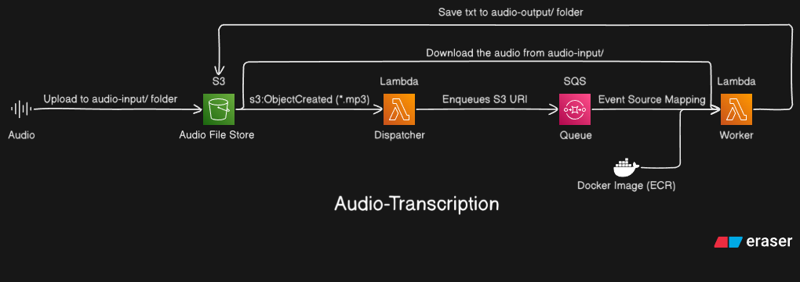

# Serverless Audio Transcription on AWS (OpenAI Whisper)

An event-driven, serverless audio transcription pipeline built on AWS using **OpenAI Whisper**, **AWS Lambda**, **Amazon SQS**, **Amazon S3**, and **Amazon ECR**, fully provisioned with **Terraform**.

---

## Architecture Overview

The system is designed to be fully event-driven, decoupled, and scalable. Audio files uploaded to Amazon S3 trigger an asynchronous processing pipeline that transcribes audio into text files using containerized OpenAI Whisper running on AWS Lambda.



### Pipeline Workflow

1. **Ingestion**: An audio file (`.mp3`) is uploaded to the S3 bucket under the `audio-input/` prefix (e.g., `s3://<bucket>/audio-input/sample.mp3`).
2. **Event Dispatching**: S3 triggers the **Dispatcher Lambda** via bucket notifications. The dispatcher normalizes the object key, forms the S3 URI (`s3://<bucket>/<key>`), and pushes it to the Amazon SQS queue.
3. **Queue & Decoupling**: **Amazon SQS** decouples ingestion from heavy processing, buffering incoming jobs, controlling concurrency, and supporting retries and dead-letter handling.
4. **Transcription (Worker Lambda)**:
   - Configured with container packaging, up to 10 GB of ephemeral storage (`/tmp`), and 3008 MB RAM.
   - Uses pre-baked **OpenAI Whisper** model and static **FFmpeg** binaries.
   - Downloads the audio file from S3 to `/tmp`, executes transcription (FP32 CPU execution), and returns partial batch failure responses (`ReportBatchItemFailures`) if processing fails.
5. **Output**: The transcript is saved as a UTF-8 text file to the S3 bucket under the `audio-output/` prefix, preserving the relative path hierarchy (e.g., `audio-output/sample.txt`).

---

## Features

- **Event-Driven & Serverless**: Zero idle compute cost; resources scale on demand.
- **Optimized Cold Starts**: Whisper model weights (e.g., `base`) are pre-downloaded to `/opt/whisper` during Docker image build rather than at runtime.
- **Large Audio Support**: Configured with 10 GB ephemeral storage (`/tmp`) and a 15-minute Lambda timeout to process lengthy audio files.
- **Resilient Batch Processing**: SQS event source mapping with `ReportBatchItemFailures` ensures only failed messages are retried.
- **Customizable Input Payload**: Worker supports both raw S3 URIs (from the dispatcher) and custom JSON messages specifying target bucket, key, and language parameters:
  ```json
  {
    "bucket": "audio-transcription-aws-bucket",
    "key": "audio-input/podcast.mp3",
    "language": "en"
  }
  ```
- **Automated Multi-Arch Image Builds**: Terraform uses Docker Buildx via `local-exec` to build and push container images to ECR directly during deployment.

---

## Project Structure

```text
Audio-Transcription-AWS/
├── Lambda/
│   ├── Dispatcher/
│   │   ├── main.py              # S3 event parser and SQS dispatcher
│   │   └── function.zip         # Packaged archive for Lambda deployment
│   └── Worker/
│       ├── Dockerfile           # Multi-stage image with FFmpeg and Whisper
│       ├── requirements.txt     # torch, openai-whisper, boto3
│       └── main.py              # SQS processor, Whisper transcriber, S3 uploader
├── Terraform/
│   ├── main.tf                  # Root module orchestrating all resources
│   ├── variables.tf             # Input variables and configurable parameters
│   ├── outputs.tf               # Infrastructure outputs (bucket, queue, ARNs)
│   ├── providers.tf             # AWS provider and default tag settings
│   ├── backend.tf               # Terraform remote state configuration
│   └── modules/
│       ├── s3_bucket/           # S3 bucket and notification configurations
│       ├── sqs/                 # SQS queue with visibility timeout
│       ├── ecr/                 # Amazon ECR container repository
│       ├── lambda_dispatcher/   # Zip-based Dispatcher Lambda & IAM roles
│       └── lambda_worker/       # Container-based Worker Lambda, buildx trigger & IAM roles
├── sample-speech-1m.mp3         # Test audio (1 minute)
├── sample-speech-5m.mp3         # Test audio (5 minutes)
├── sample-speech-10m.mp3        # Test audio (10 minutes)
├── sample-speech-20m.mp3        # Test audio (20 minutes)
├── sample-speech-30m.mp3        # Test audio (30 minutes)
├── Diagram.png                  # Architecture diagram
├── image.png                    # CloudWatch debugging reference
└── README.md
```

---

## Prerequisites

Before deploying, ensure you have the following installed and configured:

1. **AWS CLI** (v2) configured with appropriate IAM permissions:
   ```bash
   aws configure --profile your-profile
   ```
2. **Terraform** (>= 1.5.0)
3. **Docker** and **Docker Buildx** (with multi-platform build support enabled)
4. **Python 3.13+** (optional, for local script testing)

---

## Configuration

Customize your configuration in `Terraform/variables.tf` or create a `Terraform/terraform.tfvars` file:

| Variable | Description | Default |
| :--- | :--- | :--- |
| `aws_region` | AWS region to deploy resources | `ap-south-1` |
| `aws_profile` | AWS CLI profile for credentials & Docker push | `pa-abhradip` |
| `bucket_name` | Name of the primary S3 bucket | `audio-transcription-aws-bucket` |
| `sqs_name` | Name of the SQS queue | `audio-transcription-aws-sqs` |
| `ecr_repository_name` | Name of the ECR repository for worker | `audio-transcription-aws-ecr` |
| `lambda_worker_memory_size` | Worker Lambda RAM in MB | `3008` |
| `lambda_worker_timeout` | Worker Lambda timeout in seconds | `900` (15 mins) |
| `lambda_worker_ephemeral_storage`| Worker `/tmp` disk size in MB | `10240` (10 GB) |
| `lambda_worker_architecture` | Architecture (`x86_64` or `arm64`) | `x86_64` |

> [!NOTE]
> Review `Terraform/backend.tf` if you use an S3 remote state backend. Update the `bucket`, `key`, `region`, and `profile` to match your environment, or remove `backend.tf` to use local state.

---

## Deployment

### 1. Initialize Terraform

Navigate to the `Terraform` directory and initialize providers:

```bash
cd Terraform
terraform init
```

### 2. Review and Apply Plan

Ensure Docker daemon is running, then deploy the infrastructure:

```bash
terraform plan
terraform apply
```

During deployment:
- The ECR repository and S3 bucket are provisioned.
- Terraform executes Docker Buildx to package `Lambda/Worker`, pre-downloading the Whisper model, bundling static FFmpeg, and pushing the image to ECR.
- The Dispatcher and Worker Lambda functions, IAM roles, SQS queue, and event bindings are created.

---

## Testing & Usage

### 1. Upload an Audio File to S3

Upload one of the provided sample MP3 files into the `audio-input/` prefix:

```bash
aws s3 cp ../sample-speech-1m.mp3 s3://<bucket_name>/audio-input/sample-speech-1m.mp3 --profile <aws_profile>
```

### 2. Monitor Processing

- **Dispatcher Lambda**: Check CloudWatch Logs under `/aws/lambda/audio-transcription-aws-dispatcher` to confirm S3 event receipt and SQS dispatch.
- **SQS Queue**: Observe messages in flight or processed via the AWS Console or AWS CLI.
- **Worker Lambda**: Monitor execution and transcription progress in `/aws/lambda/audio-transcription-aws-worker`.

### 3. Retrieve Transcripts

Once processing completes, inspect or download the transcribed text file:

```bash
# List generated output
aws s3 ls s3://<bucket_name>/audio-output/ --profile <aws_profile>

# Download transcript
aws s3 cp s3://<bucket_name>/audio-output/sample-speech-1m.txt ./sample-speech-1m.txt --profile <aws_profile>
cat sample-speech-1m.txt
```

---

## Customization

### Changing the Whisper Model

By default, the worker uses the `base` Whisper model (`~140MB`). To change the model (e.g., `tiny`, `small`, `medium`):

1. Update the pre-download command in `Lambda/Worker/Dockerfile`:
   ```dockerfile
   RUN mkdir -p /opt/whisper && python -c "import whisper; whisper.load_model('small', download_root='/opt/whisper')"
   ```
2. Update the environment variable in `Terraform/main.tf` under `module.lambda_module_worker`:
   ```hcl
   environment_variables = {
     INPUT_BUCKET      = module.s3_bucket_module.s3_bucket_name
     OUTPUT_BUCKET     = module.s3_bucket_module.s3_bucket_name
     WHISPER_MODEL     = "small"
     WHISPER_MODEL_DIR = "/opt/whisper"
   }
   ```
3. Run `terraform apply` to rebuild the container image and update the Lambda function.

---

## Cleanup

To destroy all provisioned AWS resources when finished:

```bash
cd Terraform
terraform destroy
```
